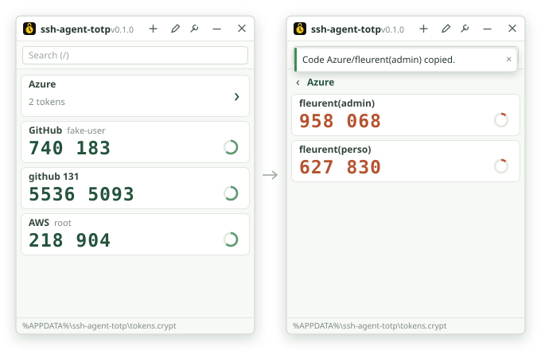
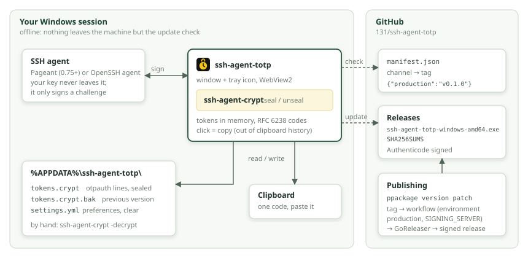

# ssh-agent-totp

## Your two-factor codes, sealed by your SSH key

A small Windows authenticator for your TOTP codes (the 6 digits of GitHub,
Azure, AWS…). It works offline: the secrets stay on your disk, encrypted by a
key of your SSH agent (Pageant or ssh-agent) with
[ssh-agent-crypt](https://github.com/131/ssh-agent-crypt). No account, no
cloud, no master password: your agent is the lock.

## How it works

## Install

Download `ssh-agent-totp-windows-amd64.exe` from the
[latest release](https://github.com/131/ssh-agent-totp/releases/latest), put it
wherever you like and run it. One signed file, nothing to install.

Your SSH agent must be running with at least one key loaded.

## What you can do

- **Codes**: click a card to copy its current code. The ring shows elapsed
  progress, filling clockwise from twelve o’clock and resetting every period. It turns red for the last seconds. Type `/` or Ctrl+F to search.
- **Add** (`+`), three tabs:
  - *Add entry*: issuer, account, base32 secret, and algorithm, digits and
    period when the service asks for them;
  - *Batch import*: paste everything in one box (`otpauth://` links, Google
    Authenticator exports, `label SECRET` lines). Tokens already present are
    skipped, lines not understood stay in the box;
  - *Export*: every token as `otpauth://` links, to move to another device.
    The text stays masked until you show it; a click on it copies it.
- **Folders**: tokens are sorted by name; `/` in a name makes folders,
  `Azure/fleurent(perso)` and `Azure/fleurent(admin)` sit in `Azure`. An
  issuer with several accounts is a folder too: `Microsoft:a` and
  `Microsoft:b` sit in `Microsoft`. Click a folder to open it, Escape to come
  back.
- **Edit mode** (pencil): rename and delete tokens, rename folders (every
  token inside follows). Out of edit mode nothing can be deleted by mistake,
  and a deletion still asks first. Use the pin/unpin icon next to each token
  to choose the flat, alphabetical tray shortcuts. The menu shows names only;
  clicking one copies its current code. Pins survive export/import.

Copied codes stay out of the Windows clipboard history and cloud clipboard.

The app lives in the notification area: closing the window (or Escape) keeps
it there. A single click (or right-click) opens the tray menu; double-click
brings back the full window. The existing dial animates at one frame per
second. A successful copy flashes a checkmark and posts a silent notification.
Use Quit in the tray menu to exit. See the [tray compromise](specs/TRAY.md).

## Your tokens

Tokens live in `%APPDATA%\ssh-agent-totp\tokens.crypt`: plain
`otpauth://totp/` links, one per line, encrypted as a whole by your SSH key.
Back it up, sync it; without the key it is useless. With it,
`ssh-agent-crypt -decrypt < tokens.crypt` gives the links back, ready for any
other authenticator, no app needed. See [tokens](specs/TOKENS.md).

## Updates

ssh-agent-totp updates itself: when a new version is out, a notification
offers to install it. Only versions signed by the same publisher are accepted.
Choose the release channel (`production` by default) and check for updates
from the settings (wrench, top left). Only the update check talks to the
network.

## Settings

Language, SSH key and updates are set from the app. Everything else lives in
`%APPDATA%\ssh-agent-totp\settings.yml`: see [settings](specs/SETTINGS.md).

## Security

Whoever uses your SSH agent can read your codes: lock your session. Secrets
are only kept in clear in memory while the app runs. Keep a backup of your
SSH key, or an export of your tokens, somewhere safe: lose the key and the
secrets are gone.

## Specifications

[Tokens](specs/TOKENS.md), [tray](specs/TRAY.md), [settings](specs/SETTINGS.md),
[releases and auto-update](specs/RELEASES.md),
[development](specs/DEVELOPMENT.md), [guideline](specs/dev_guideline.md)
(boring is good).

## Credits

- [François Leurent/131](https://github.com/131)
- [OpenAI](https://openai.com) Codex, in collaboration
- [ssh-agent-crypt](https://github.com/131/ssh-agent-crypt): secrets sealed by
  the SSH agent
- [go-webview2](https://github.com/jchv/go-webview2): WebView2 window without cgo
- Code signing, courtesy of Essilor International

See [CREDITS.md](CREDITS.md).

ISC license.
